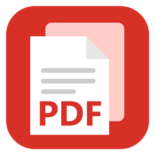

<p align="center"></p>

# myPDF

Visualizzatore PDF minimale per **Windows 10 e 11**, scritto in Rust: anteprima con le
pagine a scorrere, zoom, stampa e **unione di più PDF in uno solo**, anche da riga di comando.
È un unico `myPDF.exe` di circa 2 MB, senza installazione e senza DLL da portarsi dietro:
si copia su un altro PC e funziona.


## Download

Scarica **`myPDF.exe`** dall'ultima [Release](https://github.com/erik504/myPDF/releases/latest)
e avvialo: niente installazione. Per usarlo su un altro PC basta copiarlo.

L'eseguibile della Release 0.1.0 non è ancora firmato digitalmente: al primo avvio di un file
scaricato da internet Windows può mostrare "Windows ha protetto il PC". Clicca *Ulteriori
informazioni* → *Esegui comunque*, oppure, prima di avviarlo, tasto destro su `myPDF.exe` →
*Proprietà* → spunta *Sblocca*. Un file copiato da una chiavetta USB o dalla rete locale non
mostra l'avviso. Come firmarlo è spiegato in [Firmare l'eseguibile](#firmare-leseguibile).

## Novità

**Dopo la 0.1.0**, nel codice (l'eseguibile non cambia)
- Script [`scripts\sign.ps1`](scripts/sign.ps1) per firmare `myPDF.exe`, verificarne la firma e
  aggiornare la Release su GitHub; istruzioni in [Firmare l'eseguibile](#firmare-leseguibile).
- Il repository ignora certificati e chiavi private (`*.pfx`, `*.p12`, `*.key`).

**0.1.0** — 18 novembre 2026, prima versione
- Visualizzatore Win32 nativo: pagine a scorrere, zoom da 5% a 1600% con disegno a riquadri,
  adatta alla larghezza o alla pagina, trascinamento, scorciatoie, nitido su schermi ad alta
  risoluzione.
- Elenco dei documenti riordinabile e unione in un unico PDF, con un segnalibro per file; campi
  dei moduli e livelli conservati.
- Stampa con la finestra di Windows.
- Riga di comando: `--merge` (anche con `*.pdf` e cartelle), `--print`, `--printers`.
- PDF protetti da password; PDF troncati o danneggiati mostrati fino a dove si può, con una
  pagina *Broken PDF format*; file non PDF segnalati senza chiusure.
- Registrazione come programma per aprire i `.pdf`.

## Cosa fa

- **Visualizza** i PDF con le pagine una sotto l'altra: rotellina per scorrere, trascinamento
  con il mouse, tastiera (frecce, PagSu/PagGiù, Home/Fine, spazio).
- **Zoom** da 5% a 1600% (Ctrl+rotellina o pizzico sul touchpad, pulsanti `−`/`+`),
  *adatta alla larghezza*, *pagina intera*, *dimensioni reali*. Agli zoom forti la pagina viene
  disegnata a riquadri, così il testo resta nitido.
- **Stampa** con la finestra di stampa di Windows (stampante, pagine, copie). Le pagine più
  grandi del foglio vengono ridotte, quelle orizzontali ruotate.
- **Unisce** i documenti aperti in un unico PDF, nell'ordine dell'elenco a sinistra:
  si riordinano trascinandoli o con *Su*/*Giù* (anche Alt+↑/↓), oppure *Documenti → Ordina per nome*.
  Nel file unito c'è un segnalibro per ogni documento; campi dei moduli e livelli vengono conservati.
- **PDF protetti**: chiede la password; i PDF con solo restrizioni (password del proprietario)
  si aprono e si uniscono direttamente. Il PDF unito non è protetto.
- **File danneggiati**: di un PDF troncato o rovinato mostra le pagine che si riescono a
  leggere e poi una pagina *Broken PDF format*; se il file non è un PDF (o non se ne legge
  nulla) lo dice al posto dell'anteprima, senza mai chiudersi.
- Si può usare come **visualizzatore predefinito** dei `.pdf` (vedi sotto).
- Trascina file o cartelle nella finestra per aprirli.

### Scorciatoie

| Tasti | Azione |
|---|---|
| Ctrl+O | Apri (aggiunge all'elenco) |
| Ctrl+M | Unisci in un PDF |
| Ctrl+P | Stampa |
| Ctrl+W | Togli il documento dall'elenco |
| Ctrl++ / Ctrl+− / Ctrl+rotellina | Zoom |
| Ctrl+0 / Ctrl+1 / Ctrl+2 | Pagina intera / 100% / Larghezza |
| Ctrl+G | Vai alla pagina |
| Alt+↑ / Alt+↓ | Sposta il documento nell'elenco |
| F9 | Mostra/nascondi l'elenco dei documenti |

## Riga di comando

`myPDF.exe` senza argomenti (o con dei file) apre l'interfaccia. Questi comandi invece
lavorano **senza aprire il visualizzatore**:

```bat
:: Unire dei PDF, nell'ordine dato
myPDF.exe --merge unito.pdf primo.pdf secondo.pdf terzo.pdf

:: Tutti i PDF di una cartella (o con * e ?), in ordine naturale (2 prima di 10)
myPDF.exe --merge -y tutte.pdf "C:\Scansioni\*.pdf"
myPDF.exe --merge fatture.pdf C:\Fatture

:: Stampa: senza stampante indicata si apre la finestra di stampa di Windows
myPDF.exe --print documento.pdf
myPDF.exe --print documento.pdf --printer "HP LaserJet" --pages 1-3,5 --copies 2
myPDF.exe --print *.pdf --default-printer
myPDF.exe --printers
```

Opzioni di `--merge` (sinonimi `-m`, `/merge`, `--unisci`): `-o <file>` uscita, `-y` sovrascrive
un file esistente (senza, myPDF si ferma), `--no-bookmarks`, `--password <pw>` (anche più volte),
`-q` silenzioso. Un PDF danneggiato viene unito con le pagine leggibili e un avviso.

Opzioni di `--print` (sinonimi `/p`, `--stampa`): `--printer "<nome>"` o `--default-printer`
per stampare subito senza finestra, `--pages`, `--copies`, `--password`, `-q`.

Codici di uscita: `0` riuscito, `1` errore, `2` parametri sbagliati, `3` stampa annullata.
`myPDF.exe --help` mostra l'elenco completo.

> myPDF è un programma a finestre (così aprendo un PDF da Esplora file non compare una
> console). Nel Prompt dei comandi interattivo usa `start /wait myPDF.exe --merge ...` per
> aspettare la fine; nei file `.bat` l'attesa è automatica; in PowerShell
> `myPDF.exe --merge ... | Out-Host`.

## Visualizzatore predefinito dei PDF

Menu **? → Usa myPDF per aprire i PDF…** (oppure `myPDF.exe --register`). myPDF si registra
per l'utente corrente (senza diritti di amministratore) e si apre la pagina *App predefinite*
di Windows, dove scegliere myPDF per `.pdf`: Windows 10 e 11 non permettono a un programma di
diventare predefinito da solo. Vengono registrati anche *Stampa* e *Stampa su* del menu
contestuale di Esplora file. Se sposti `myPDF.exe`, ripeti il comando;
`--unregister` toglie tutto.

## Requisiti

- Windows 10 (versione 1607 o successiva) oppure Windows 11, a 64 bit (sui PC ARM funziona
  tramite l'emulazione x64).
- Nient'altro: le pagine sono disegnate dal motore PDF integrato in Windows
  (`Windows.Data.Pdf`), il runtime C è dentro l'eseguibile.

## Compilare

Serve Rust 1.88 o successivo con il toolchain MSVC (Visual Studio Build Tools con Windows SDK).

```bat
cargo build --release
cargo test
```

L'eseguibile è `target\release\myPDF.exe`; per distribuirlo conviene firmarlo (vedi
[Firmare l'eseguibile](#firmare-leseguibile)).

Struttura del codice:

| File | Contenuto |
|---|---|
| `src/render.rs` | apertura dei file e disegno delle pagine con `Windows.Data.Pdf` |
| `src/repair.rs` | recupero delle pagine leggibili dai PDF danneggiati o troncati |
| `src/merge.rs` | unione dei PDF con [lopdf](https://github.com/J-F-Liu/lopdf) |
| `src/print.rs` | finestra di stampa e stampa con GDI |
| `src/cli.rs` | riga di comando |
| `src/assoc.rs` | registrazione per i file `.pdf` |
| `src/gui/` | interfaccia Win32: finestra principale, visualizzatore a riquadri, thread di disegno |

I test (`cargo test`) provano anche il motore di Windows vero, la riga di comando sull'eseguibile
e la stampa su *Microsoft Print to PDF* (saltata se quella stampante non c'è).

## Firmare l'eseguibile

La firma digitale fa comparire il nome dell'autore al posto di "Autore sconosciuto" e garantisce
che il file non è stato modificato. L'avviso SmartScreen ("Windows ha protetto il PC") però non
sparisce subito: Windows lo toglie man mano che il programma viene scaricato e usato, cioè quando
accumula *reputazione*. Dal 2024 anche i costosi certificati EV non danno più fiducia immediata:
non serve comprarli per questo.

### 1. Procurarsi un certificato

- **Certum Open Source Code Signing nel cloud (SimplySign)**: pensato per gli sviluppatori open
  source privati, come per myPDF. La chiave resta nel cloud di Certum: si firma dal PC con l'app
  SimplySign Desktop e un codice dall'app SimplySign sul telefono, senza chiavetta. Serve la verifica
  dell'identità con un documento; nel certificato compare "Open Source Developer, Nome Cognome".
- In alternativa un certificato OV ("Standard Code Signing") di Certum, Sectigo, SSL.com o altri:
  funziona allo stesso modo, ma costa di più.
- *Azure Artifact Signing* di Microsoft oggi è disponibile per le persone fisiche solo in USA e
  Canada.
- Un certificato creato da sé (autofirmato) non serve: sugli altri PC Windows non lo riconosce.

Per prezzi e disponibilità aggiornati controlla i siti dei fornitori.

### 2. Preparare il PC

1. **signtool**, lo strumento di firma di Microsoft: è nel Windows SDK. Se hai già compilato
   myPDF ce l'hai; altrimenti installa il Windows SDK scegliendo almeno *Windows SDK Signing Tools
   for Desktop Apps*. Lo script lo trova da solo.
2. **Il certificato**: con Certum, installa SimplySign Desktop e collegati (codice dall'app sul
   telefono). Finché è collegato, il certificato compare tra quelli di Windows. Per vederne il nome
   esatto:

   ```powershell
   Get-ChildItem Cert:\CurrentUser\My -CodeSigningCert | Format-List Subject, Thumbprint, NotAfter
   ```

### 3. Firmare

Dalla cartella del progetto, con il nome del tuo certificato (la parte dopo `CN=` di *Subject*):

```powershell
.\scripts\sign.ps1 -CertName "Open Source Developer, Mario Rossi"
```

Lo script firma `myPDF.exe` con SHA-256 e marca temporale (così la firma resta valida anche dopo
la scadenza del certificato), poi la controlla come fa Windows e mostra autore, scadenza, marca
temporale e impronta SHA-256. Codici di uscita: `0` firma valida e attendibile, `2` firma presente
ma non attendibile (per esempio un certificato di prova), `1` errore.

Altre possibilità:
- `-Build` ricompila prima di firmare;
- `-Thumbprint <impronta>` oppure `-PfxFile <file> -PfxPassword <password>` al posto di `-CertName`;
  se nell'archivio di Windows c'è un solo certificato di firma, si può anche non indicare nulla;
- per non riscrivere il nome ogni volta: `$env:MYPDF_SIGN_CERT = "Open Source Developer, Mario Rossi"`;
- `-File <percorso>` per firmare un altro file;
- `Get-Help .\scripts\sign.ps1 -Full` mostra tutte le opzioni.

Se Windows PowerShell dice che l'esecuzione degli script è disabilitata, avvialo così (vale solo
per quel comando, non cambia le impostazioni):

```powershell
powershell -ExecutionPolicy Bypass -File .\scripts\sign.ps1 -CertName "Open Source Developer, Mario Rossi"
```

Per controllare a mano: tasto destro su `myPDF.exe` → *Proprietà* → scheda *Firme digitali*, oppure:

```powershell
Get-AuthenticodeSignature .\myPDF.exe | Format-List Status, SignerCertificate, TimeStamperCertificate
```

### 4. Pubblicare

Per sostituire l'eseguibile nella Release di GitHub e aggiornarne l'impronta SHA-256 nelle note:

```powershell
.\scripts\sign.ps1 -Build -CertName "Open Source Developer, Mario Rossi" -Upload
```

Serve [GitHub CLI](https://cli.github.com/) (`gh`) con l'accesso al repository. La Release è quella
della versione scritta in `Cargo.toml`, e lo script carica il file solo se la firma è attendibile.

Ricorda:
- firma ogni nuova versione: una modifica all'eseguibile annulla la firma;
- i file del certificato (`.pfx`, `.p12`, `.key`) non vanno mai nel repository: il `.gitignore`
  li esclude già.

## Limiti

- Non si può selezionare o cercare il testo, né modificare i PDF.
- Nell'unione non vengono conservati i segnalibri originali dei singoli file (ne viene creato
  uno per file), i collegamenti a destinazioni con nome e la struttura per l'accessibilità.

## Licenza

MIT — vedi [LICENSE](LICENSE).
