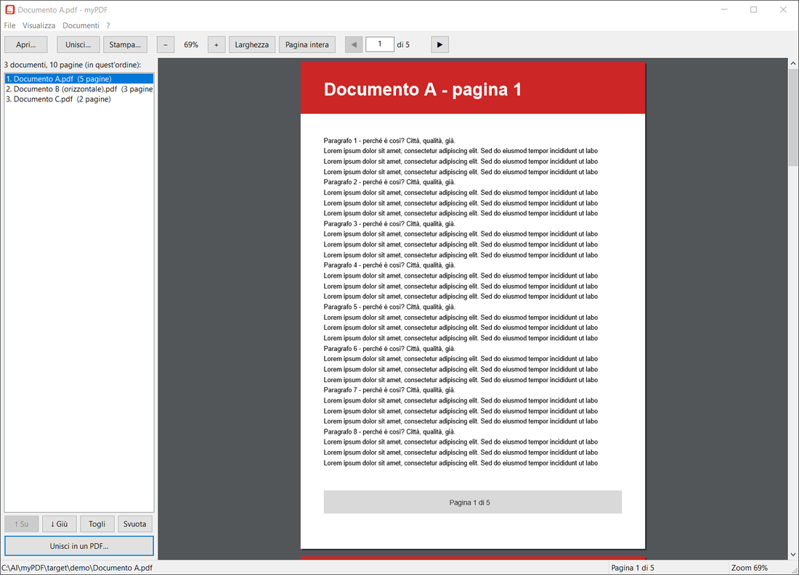

<p align="center"></p>

# myPDF

Visualizzatore PDF minimale per **Windows 10 e 11**, scritto in Rust: anteprima con le
pagine a scorrere, zoom, stampa e **unione di più PDF in uno solo**, anche da riga di comando.
È un unico `myPDF.exe` di circa 2 MB, senza installazione e senza DLL da portarsi dietro:
si copia su un altro PC e funziona.



## Cosa fa

- **Visualizza** i PDF con le pagine una sotto l'altra: rotellina per scorrere, trascinamento
  con il mouse, tastiera (frecce, PagSu/PagGiù, Home/Fine, spazio).
- **Zoom** da 5% a 1600% (Ctrl+rotellina o pizzico sul touchpad, pulsanti `−`/`+`),
  *adatta alla larghezza*, *pagina intera*, *dimensioni reali*. Agli zoom forti la pagina viene
  disegnata a riquadri, così il testo resta nitido.
- **Stampa** con la finestra di stampa di Windows (stampante, pagine, copie). Le pagine più
  grandi del foglio vengono ridotte, quelle orizzontali ruotate.
- **Unisce** i documenti aperti in un unico PDF, nell'ordine dell'elenco a sinistra:
  si riordinano trascinandoli o con *Su*/*Giù* (anche Alt+↑/↓), oppure *Documenti → Ordina per nome*.
  Nel file unito c'è un segnalibro per ogni documento; campi dei moduli e livelli vengono conservati.
- **PDF protetti**: chiede la password; i PDF con solo restrizioni (password del proprietario)
  si aprono e si uniscono direttamente. Il PDF unito non è protetto.
- **File danneggiati**: di un PDF troncato o rovinato mostra le pagine che si riescono a
  leggere e poi una pagina *Broken PDF format*; se il file non è un PDF (o non se ne legge
  nulla) lo dice al posto dell'anteprima, senza mai chiudersi.
- Si può usare come **visualizzatore predefinito** dei `.pdf` (vedi sotto).
- Trascina file o cartelle nella finestra per aprirli.

### Scorciatoie

| Tasti | Azione |
|---|---|
| Ctrl+O | Apri (aggiunge all'elenco) |
| Ctrl+M | Unisci in un PDF |
| Ctrl+P | Stampa |
| Ctrl+W | Togli il documento dall'elenco |
| Ctrl++ / Ctrl+− / Ctrl+rotellina | Zoom |
| Ctrl+0 / Ctrl+1 / Ctrl+2 | Pagina intera / 100% / Larghezza |
| Ctrl+G | Vai alla pagina |
| Alt+↑ / Alt+↓ | Sposta il documento nell'elenco |
| F9 | Mostra/nascondi l'elenco dei documenti |

## Riga di comando

`myPDF.exe` senza argomenti (o con dei file) apre l'interfaccia. Questi comandi invece
lavorano **senza aprire il visualizzatore**:

```bat
:: Unire dei PDF, nell'ordine dato
myPDF.exe --merge unito.pdf primo.pdf secondo.pdf terzo.pdf

:: Tutti i PDF di una cartella (o con * e ?), in ordine naturale (2 prima di 10)
myPDF.exe --merge -y tutte.pdf "C:\Scansioni\*.pdf"
myPDF.exe --merge fatture.pdf C:\Fatture

:: Stampa: senza stampante indicata si apre la finestra di stampa di Windows
myPDF.exe --print documento.pdf
myPDF.exe --print documento.pdf --printer "HP LaserJet" --pages 1-3,5 --copies 2
myPDF.exe --print *.pdf --default-printer
myPDF.exe --printers
```

Opzioni di `--merge` (sinonimi `-m`, `/merge`, `--unisci`): `-o <file>` uscita, `-y` sovrascrive
un file esistente (senza, myPDF si ferma), `--no-bookmarks`, `--password <pw>` (anche più volte),
`-q` silenzioso. Un PDF danneggiato viene unito con le pagine leggibili e un avviso.

Opzioni di `--print` (sinonimi `/p`, `--stampa`): `--printer "<nome>"` o `--default-printer`
per stampare subito senza finestra, `--pages`, `--copies`, `--password`, `-q`.

Codici di uscita: `0` riuscito, `1` errore, `2` parametri sbagliati, `3` stampa annullata.
`myPDF.exe --help` mostra l'elenco completo.

> myPDF è un programma a finestre (così aprendo un PDF da Esplora file non compare una
> console). Nel Prompt dei comandi interattivo usa `start /wait myPDF.exe --merge ...` per
> aspettare la fine; nei file `.bat` l'attesa è automatica; in PowerShell
> `myPDF.exe --merge ... | Out-Host`.

## Visualizzatore predefinito dei PDF

Menu **? → Usa myPDF per aprire i PDF…** (oppure `myPDF.exe --register`). myPDF si registra
per l'utente corrente (senza diritti di amministratore) e si apre la pagina *App predefinite*
di Windows, dove scegliere myPDF per `.pdf`: Windows 10 e 11 non permettono a un programma di
diventare predefinito da solo. Vengono registrati anche *Stampa* e *Stampa su* del menu
contestuale di Esplora file. Se sposti `myPDF.exe`, ripeti il comando;
`--unregister` toglie tutto.

## Requisiti

- Windows 10 (versione 1607 o successiva) oppure Windows 11, a 64 bit (sui PC ARM funziona
  tramite l'emulazione x64).
- Nient'altro: le pagine sono disegnate dal motore PDF integrato in Windows
  (`Windows.Data.Pdf`), il runtime C è dentro l'eseguibile.

## Compilare

Serve Rust 1.88 o successivo con il toolchain MSVC (Visual Studio Build Tools con Windows SDK).

```bat
cargo build --release
cargo test
```

L'eseguibile è `target\release\myPDF.exe`.

### Firmare l'eseguibile

Senza firma, al primo avvio di un file scaricato Windows mostra l'avviso SmartScreen
("Windows ha protetto il PC"). La firma con un certificato di firma del codice mostra il nome
dell'autore; l'avviso sparisce man mano che il programma accumula download (dal 2024 anche i
certificati EV non danno più fiducia immediata). Per uno sviluppatore privato di un progetto open
source va bene, per esempio, il certificato *Open Source Code Signing* di Certum nel cloud
(SimplySign).

[`scripts\sign.ps1`](scripts/sign.ps1) firma `myPDF.exe` con `signtool` (dal Windows SDK), con
SHA-256 e marca temporale, e poi verifica la firma come fa Windows:

```powershell
# firma myPDF.exe nella cartella del progetto
.\scripts\sign.ps1 -CertName "Open Source Developer, Mario Rossi"

# ricompila, firma, verifica e sostituisce l'exe nella Release di GitHub (con l'impronta SHA-256 nelle note)
.\scripts\sign.ps1 -Build -CertName "Open Source Developer, Mario Rossi" -Upload
```

Il certificato si indica con `-CertName`, `-Thumbprint` oppure `-PfxFile`/`-PfxPassword` (o con le
variabili d'ambiente `MYPDF_SIGN_CERT` / `MYPDF_SIGN_THUMBPRINT`); con Certum SimplySign basta che
l'app SimplySign Desktop sia connessa. Con `-Upload` l'eseguibile viene caricato solo se la firma è
attendibile per Windows. `Get-Help .\scripts\sign.ps1 -Full` mostra tutte le opzioni.

Struttura del codice:

| File | Contenuto |
|---|---|
| `src/render.rs` | apertura dei file e disegno delle pagine con `Windows.Data.Pdf` |
| `src/repair.rs` | recupero delle pagine leggibili dai PDF danneggiati o troncati |
| `src/merge.rs` | unione dei PDF con [lopdf](https://github.com/J-F-Liu/lopdf) |
| `src/print.rs` | finestra di stampa e stampa con GDI |
| `src/cli.rs` | riga di comando |
| `src/assoc.rs` | registrazione per i file `.pdf` |
| `src/gui/` | interfaccia Win32: finestra principale, visualizzatore a riquadri, thread di disegno |

I test (`cargo test`) provano anche il motore di Windows vero, la riga di comando sull'eseguibile
e la stampa su *Microsoft Print to PDF* (saltata se quella stampante non c'è).

## Limiti

- Non si può selezionare o cercare il testo, né modificare i PDF.
- Nell'unione non vengono conservati i segnalibri originali dei singoli file (ne viene creato
  uno per file), i collegamenti a destinazioni con nome e la struttura per l'accessibilità.

## Licenza

MIT — vedi [LICENSE](LICENSE).
